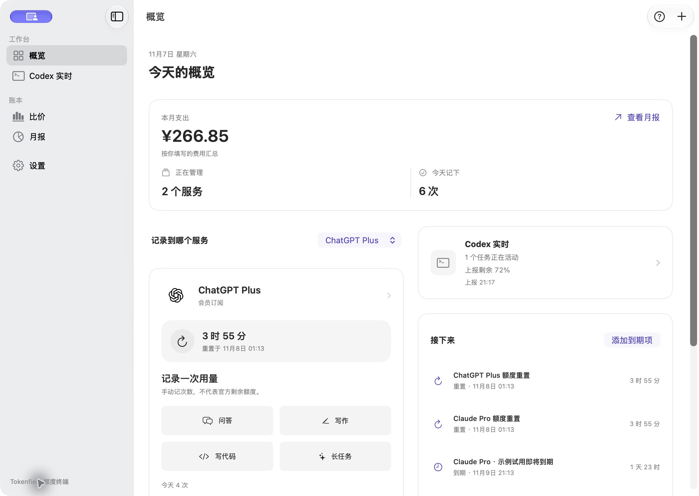
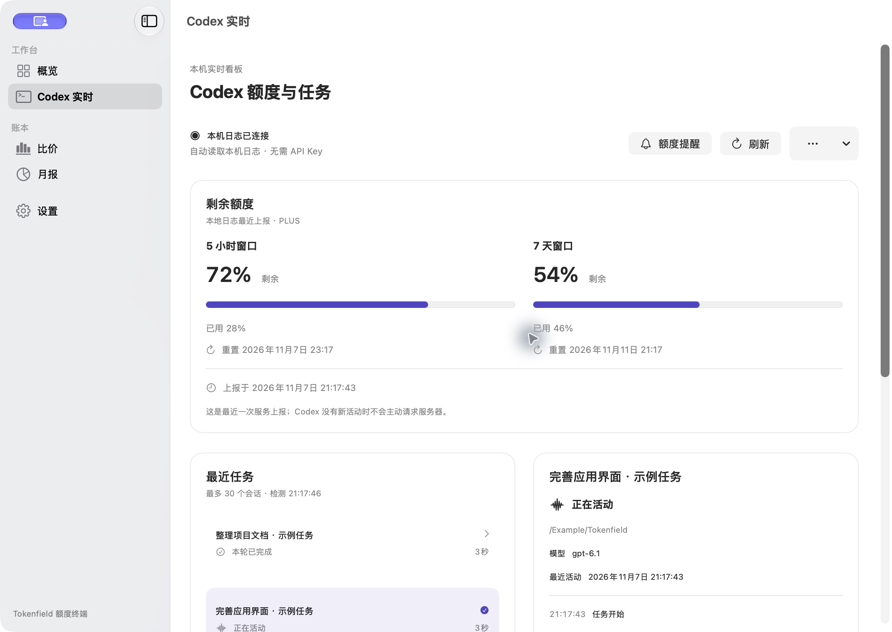
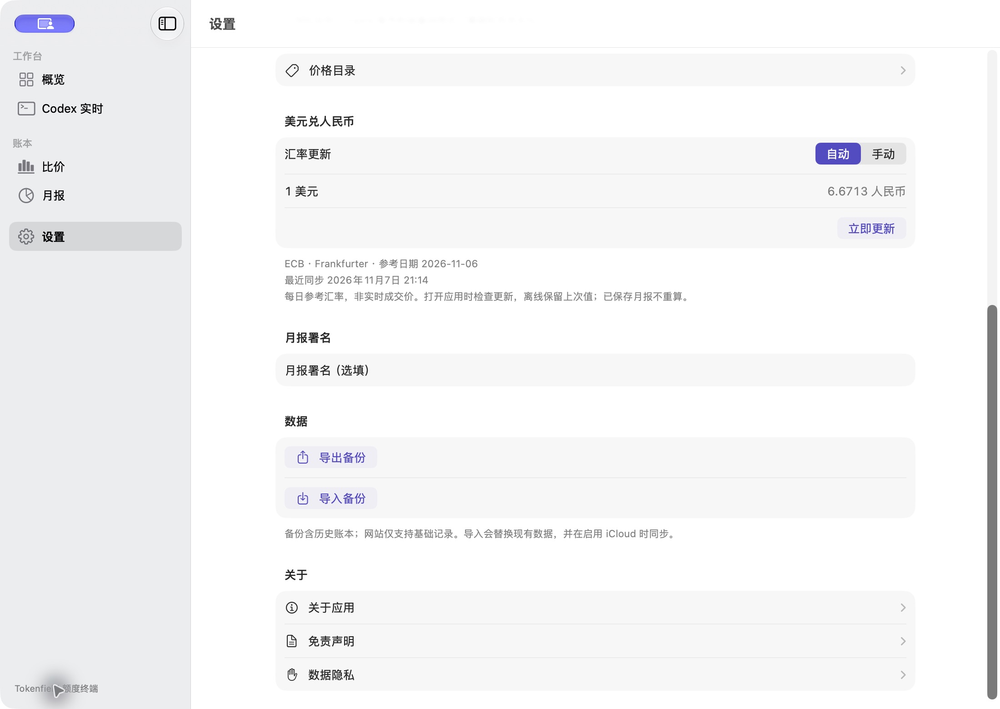

    Tokenfield · 额度终端

把 AI 订阅、花费和 Codex 额度放在一起。

Tokenfield 是一款面向 Mac 和 iPhone 的原生 AI 使用管理工具。记下订阅费用和使用次数，查看月报；在 Mac 上，还能自动连接本机 Codex 日志，查看最近上报的额度和任务状态。

[下载 Mac 版](https://github.com/Lysandrazyq/tokenfield/releases/latest) · [1.5.0 更新说明](docs/releases/v1.5.0.md) · [构建说明](docs/BUILD.md)

    能做什么

- **管理 AI 订阅与花费**：订阅、按量付费和余额账户放在同一份账本中，续费与到期事项集中查看。
- **快捷记录与月报**：用完记一次，记错可撤销；保存历史月报，导出备份。
- **Mac Codex 实时看板**：自动发现本机日志，无需 API Key。额度显示上报时间与重置时间，任务区分活动、完成、停止和暂无新活动。
- **状态栏额度圆环**：外圈显示两个有效额度窗口中较低的剩余比例，中心呈现任务活动状态。点开可查看数值并打开看板。
- **额度低位提醒**：剩余 20% 时预警、10% 时紧急提醒，同一窗口周期去重；默认关闭，在看板中确认来源后开启。
- **自动参考汇率**：美元兑人民币参考值自动更新，显示来源、参考日期和同步时间，离线保留上次值，也可切换手动。

使用系统字体、原生控件和深浅色外观，动效遵守系统“减少动态效果”设置。

    Codex 额度与任务

打开 Mac 应用后自动检测 `~/.codex`，也可选择自定义目录。看板读取本机已上报的元数据，不读取登录凭据，不保存聊天正文、推理或命令输出，不上传 Codex 数据。

额度来自最近有效日志，不主动查询服务器；超过时效或重置时间会显示未知。任务没有可靠总量，因此不显示虚构的完成百分比。同目录切换 Codex 账号后，需在额度提醒中重新确认来源并等待新上报。

    自动汇率

在“设置 → 美元兑人民币”切换自动或手动。自动模式使用 [Frankfurter 提供的 ECB 参考汇率](https://frankfurter.dev/providers/ecb/)，成功后缓存 6 小时；也可点“立即更新”。这是每日参考值，非实时成交价。更新只影响当前计算，已保存月报保留原记录。

    Mac 与 iPhone

两个原生端共用账本格式，可通过 JSON 导出、导入迁移记录。当前发行包尚未启用 iCloud 自动同步；Codex 本机看板、额度提醒与状态栏圆环仅在 Mac 提供。

本页截图来自 1.5.0 原生 Mac 版，账本和 Codex 会话使用示例数据。

    安装 Mac 版

1. 从 [Releases](https://github.com/Lysandrazyq/tokenfield/releases/latest) 下载通用 DMG，支持 Apple 芯片与 Intel。
2. 更新前正常退出旧应用，将“额度终端.app”拖入 Applications。
3. 从“应用程序”打开。包内另附有独立图标的“卸载旧版本.app”，可将识别出的旧应用移到废纸篓，保留账本和设置。

系统要求：macOS 14 或更新版本。macOS 26 及以上使用系统 Liquid Glass 外观。

当前包采用本地临时签名，尚未经过 Developer ID 签名与 Apple 公证，首次打开可能受到 Gatekeeper 限制。校验文件与安装包一同提供。

    项目结构

| 路径 | 内容 |
| --- | --- |
| `native-ios/Tokenfield` | 共用 SwiftUI 界面与 Mac 服务 |
| `native-ios/Packages/TokenfieldCore` | 账本、月报、只读遥测与纯规则 |
| `native-ios/Tests` | Mac 连接、提醒、菜单和汇率回归 |
| `native-mac-installer` | 旧版本卸载助手 |
| `src` | 早期网页版本 |

本次验证：Core 94 项、Mac 提醒／菜单／汇率 30 项、Mac 连接 13 项、iOS 业务 34 项通过。通用安装包的架构、签名与校验和已核对。构建方式见 [开发说明](docs/BUILD.md)，第三方资源见 [CREDITS](CREDITS.md)。
