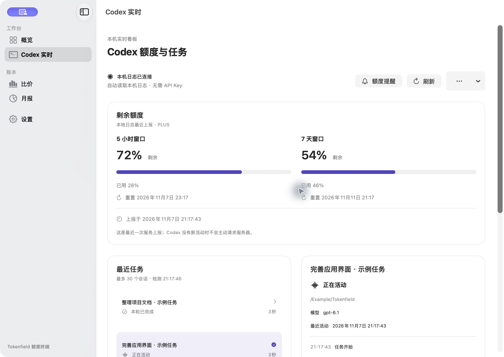
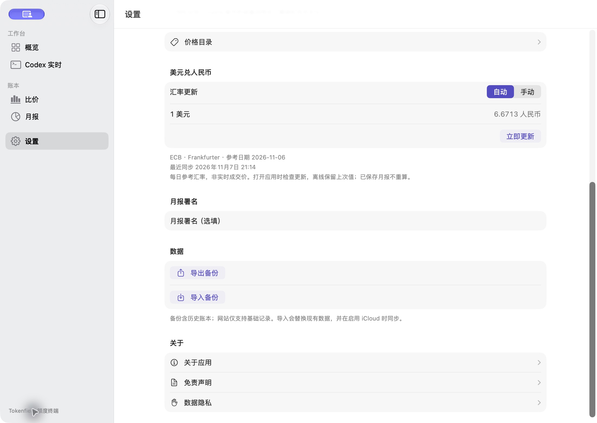

    Tokenfield 1.5.0 · 额度终端

这次更新把 Codex 额度放进 Mac 状态栏，并加入额度提醒和自动汇率。

    新增

- **状态栏圆环**：外圈显示两个有效额度窗口中较低的剩余比例；中心活动弧、勾号和方块分别表示任务活动、明确完成和停止。未知或过期时显示虚线圈。图形经过缩小和收细，保留原生点击区。
- **Codex 额度提醒**：20% 预警可选，10% 紧急提醒保留；两窗口同时低位合并通知，同周期同等级去重。默认关闭，可在“Codex 实时 → 额度提醒”确认来源后开启。
- **自动美元兑人民币参考汇率**：来源为 ECB / Frankfurter，分别显示参考日期和同步时间；成功后缓存 6 小时，支持立即更新、手动模式和离线保留。已保存月报不重算。

    调整与修复

- 将首页使用指南问号移到右上角，与添加按钮合组。
- 保留切换页面前未保存的设置草稿，避免从看板导航时丢失输入。
- 修复提醒刷新、来源切换和通知去重中的冲突；Codex 提醒与续费／到期提醒分别管理。
- 保留白黑背景、系统字体、深浅色外观、主应用叠卡 Logo 与独立卸载助手图标。

    下载与安装

下载本页附带的 macOS universal DMG，支持 Apple 芯片与 Intel，要求 macOS 14 或更新版本。更新前正常退出旧应用，再拖入 Applications。包内附带“卸载旧版本.app”，只移走识别出的旧应用，保留账本与设置。

安装包采用本地临时签名，尚未经过 Developer ID 签名与 Apple 公证，首次打开可能受到 Gatekeeper 限制。SHA-256 校验文件一同提供。

    使用范围

Codex 额度取最近有效的本机日志，不是服务器实时查询；无确定总量的任务不显示完成百分比。切换 Codex 账号后，请在提醒设置中重新确认，并等待新上报。提醒需要额度终端保持运行，实际显示受系统通知设置影响。

Mac 和 iPhone 可通过 JSON 备份迁移账本，当前发行包尚未启用 iCloud 自动同步；Codex 实时功能仅 Mac。iPhone 代码已包含在仓库中，本次不提供 App Store、TestFlight 或 IPA 下载。

验证通过：Core 94 项、Mac 提醒／菜单／汇率 30 项、Mac 连接 13 项、iOS 业务 34 项；通用架构、签名、校验和及安装数据核对通过。
